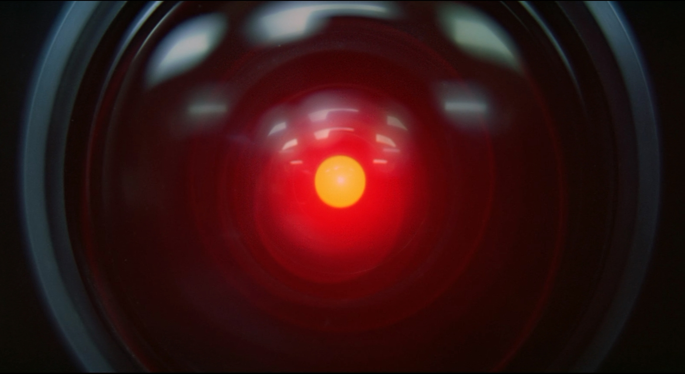
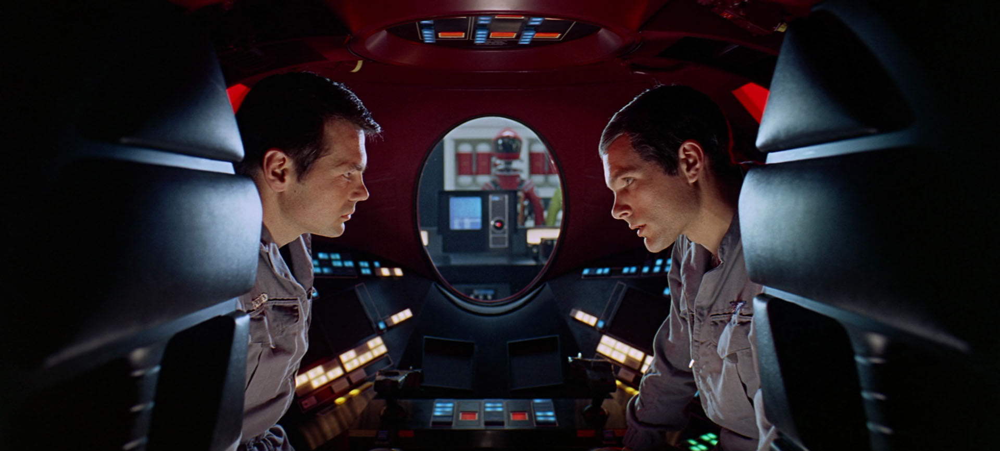
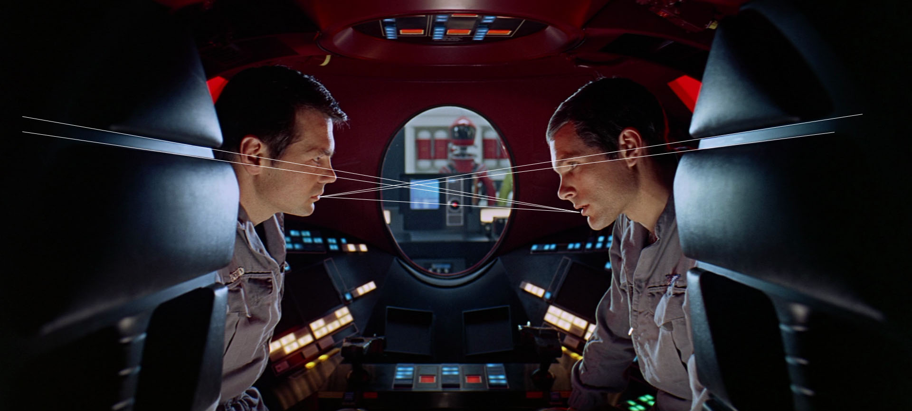
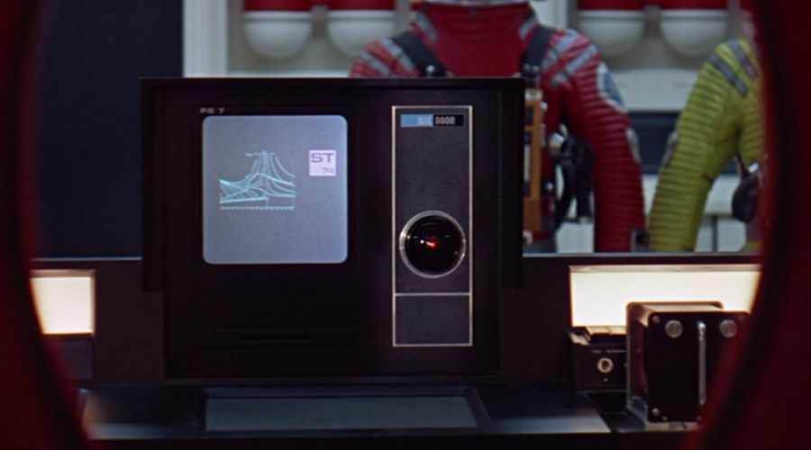
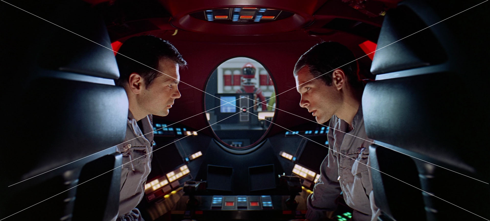
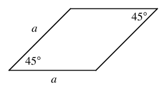

Inspired by the [TYPESET IN THE FUTURE](https://typesetinthefuture.com/) blog and especially ['2001: A Space Odyssey'](https://typesetinthefuture.com/2014/01/31/2001-a-space-odyssey/) article, I decided to write the specific homage to Kubrick. Having seen most of his movies, ['2001'](http://www.imdb.com/title/tt0062622/) more than 30 times, and tending to get my hands on any available hardcopy, digital reference or documentary, it's no secret I'm Kubrick fan.

His attention to detail is legendary, often almost beyond reason, but he had a rationale for everything. Just a few anecdotes: insisting ['Dr. Strangelove'](http://www.imdb.com/title/tt0057012/) war room table to be poker-green although the movie is black & white; hiring a man to film every door entrance with specific dimensions in London area for ['Eyes Wide Shut'](http://www.imdb.com/title/tt0120663/) just to find out after 2 years of work and thousands of photos none of them fit the purpose and building the custom one; executing more than [140 takes](http://www.slantmagazine.com/film/review/the-shining) for the single ['The Shining'](http://www.imdb.com/title/tt0081505/) scene; using rare NASA Apollo program f/0.7 prime lenses (now called [Kubrick's lenses](http://www.dpreview.com/articles/9811242514/kubrick-s-f-0-7-lenses-now-available-for-rent-but-start-saving-up)) to capture ['Barry Lyndon'](http://www.imdb.com/title/tt0072684/) dinner scene lit only by candlelight; trying to buy the insurance against the possible financial losses on ['2001'](http://www.imdb.com/title/tt0062622/) in the case the extraterrestrial intelligence would really be discovered just before the movie release, London's Lloyd's refused to issue one...

Filming of ['2001'](http://www.imdb.com/title/tt0062622/) started December 29, 1965 in [Shepperton Studios](https://en.wikipedia.org/wiki/Shepperton_Studios) in England, the only studio that could contain this huge set. Some parts of ['Dr. Strangelove'](http://www.imdb.com/title/tt0057012/) were done there just a few years earlier. The moon monolith scene was the first one to be recorded, with Kubrick filming the hand-held shots himself. [Super Panavision 70](https://en.wikipedia.org/wiki/Super_Panavision_70) format was used, resulting in 2.20 image aspect ratio. The digitized version I use has 1920×866 resolution, so it's vertically 7 pixels short to produce 2.20 ratio. This fact will reflect in the following analysis. I want these pixels back! :)

Monolith was initially envisioned as a tetrahedron, as described in Arthur C. Clarke's short story ['Sentinel'](<https://en.wikipedia.org/wiki/The_Sentinel_(short_story)>) the movie is based on. But the design was changed to cuboid due to lighting problems and by not appearing mystical enough. Its proportions are 1:4:9 ($1^2 : 2^2 : 3^2$), 9:4=2.25 aspect ratio for the most recognizable front side. The fact the film picture and the monolith ratios are so close gives a special meaning to the opening sequence of the digitized version. Its first 3 minutes are a black screen, as if the monolith is looking at you, making you wonder what is going on, and daring you to touch it. During the entire sequence we hear [György Ligeti's](https://en.wikipedia.org/wiki/Gy%C3%B6rgy_Ligeti) [Atmosphères](https://en.wikipedia.org/wiki/Atmosph%C3%A8res), the piece accompanying all monolith appearances. It was suggested to Kubrick by his wife who heard it on the radio. Ligeti didn't know Kubrick used his music, so when he went to see the movie, he thought this is some kind of a joke on him.

In the cinema there was no black screen. This music was the overture, played with the curtain closed until the first image was projected. The [Essential Presentation Procedure](https://www.in70mm.com/presents/1959_super_panavision/1968_2001/cue_sheet/index.htm) that Metro-Goldwyn-Mayer distributed to cinemas demands it:

> Play OVERTURE music (3 minutes) with full House lights on. Dim House lights towards end of overture - allow for Censor certificate and open full screen on LION TRADE MARK

Although done in the 60's, most of the film still looks modern and fresh as done a few weeks ago. So much that the world had to wait for almost 50 years until [Alfonso Cuarón](http://www.imdb.com/name/nm0190859/)'s spectacular ['Gravity'](http://www.imdb.com/title/tt1454468/) didn't top it using all the wonders of modern technology. In the original script HAL was envisioned as a real robot, with arms, legs and everything, but that way it wasn't possible to produce the timeless design. Using 60's technology it would look silly, and Kubrick knew it. So redesigning it as a mere circle decorated with [Planckian locus](https://en.wikipedia.org/wiki/Planckian_locus) (black body radiation) colors did the trick, this layout simply can't get old, it looks universal, like a star. This was accomplished by putting an ordinary light bulb behind the [Nikkor 8mm f/8](http://petapixel.com/2013/02/10/the-infamous-hal-9000-was-built-around-an-nikkor-8mm-f8-fisheye-lens/) fisheye lens. Kubrick used this design principle not only in the Odyssey, but other movies as well.

There is too much to be said about the movie, so just to demonstrate the level of detail, I will try to scratch the surface by describing the composition of the single shot. This is the scene when Poole and Bowman become suspicious of HAL's decision power and sanity. So they close themselves into one of three EVA pods and discuss what to do next. The title of this chapter is 'Bad Feeling'. Click on the image to zoom.

HAL is the central figure of the movie, and in this scene it is literally placed in the center. The positioning is precise, and it would be pixel-perfect if a few pixels weren't missing at the top of the digitized version.

Kubrick started his career as a photographer and documentary journalist. This fact is important for understanding his work. Every scene he took is a precisely crafted photo. Usual focal points of the photograph are eyes, or similar points any observer is naturally drawn to. It is important to position them in such a way to get the consistent composition.

With HAL already being in the center of the scene, other important points are set in some [golden ratio](https://en.wikipedia.org/wiki/Golden_ratio) positions, or along the leading lines, as will be discussed later. For this particular scene Kubrick used pentagonal design for Poole and Bowman's eye positions. This approach is closely related to the [golden ratio](https://en.wikipedia.org/wiki/Golden_ratio), and was often used by classic artists. It was mastered by 17th century [Nicolas Poussin](https://en.wikipedia.org/wiki/Nicolas_Poussin) with his [Et in Arcadia ego](https://en.wikipedia.org/wiki/Et_in_Arcadia_ego) being the most famous example, where he placed the mysterious women's eye in the center of the [design pentagon](Poussin_Et_in_Arcadia_ego_geom.jpg). Poussin's image interpretation is still the topic of vivid discussions, but it is known it is somehow related to death, just as this ['2001'](http://www.imdb.com/title/tt0062622/) scene, with Poole ending death in the following minutes of the movie as a direct consequence of the conversation.

Pentagon is positioned pixel-perfect, HAL in the center, Poole and Bowman's eyes on left and right upper arms, and EVA pod controls on the remaining three pentagon arms. So there is no doubt who calls the shots!

By the age 28 he finished his third film, ['The Killing'](http://www.imdb.com/title/tt0049406/), first on the Hollywood budget. During the filming he had a dispute with highly accomplished cinematographer and director of photography [Lucien Ballard](https://en.wikipedia.org/wiki/Lucien_Ballard) (Academy Award nominee 1963), also working on the movie. According to the story, Ballard modified Kubrick's camera setup to make it more reasonable regarding the lens focal length. Kubrick did not like that as the change in the scene perspective wasn't taken into account, so he had to undo the setup to the initial one, almost firing Ballard in the process.

Some would consider perspective to be a minor detail considering all the elements, but the following analysis demonstrates why it matters and to what precision Kubrick used it. Left and right sides of the scene are dominated by two black chairs. Their back feature the characteristic lines used in the composition as the leading lines. In photography, leading lines are used to lead the eye through the picture, to suggest focal point(s) and to define the important elements of the image. Chair lines are masterfully used to point to Poole and Bowman's ears and mouths, suggesting they are talking to each other. And again, the precision is astonishing, with lines precisely enveloping their ear canals and meeting exactly in front of their mouths. One of these lines (right-bottom one) is the 'super-line' additionally passing exactly through the Bowman's eye and 'HAL 9000' writing.

Just as this wasn't enough, the line connecting two mouth points passes precisely through HAL, pixel perfect! This suggests HAL being the middle man, eavesdropping on the conversation. If the perspective is to be changed by as little as 1%, none of this would happen.

Bottom pair of chair leading lines point to 'HAL 9000' writing.

Two of bottom chair lines combined with the main diagonals form the perfect [lozenge](http://mathworld.wolfram.com/Lozenge.html), rhombus whose acute angles are exactly 45.0 deg.

These are geometrical features I was able to identify, but I'm sure there are more. It's no wonder actors look a bit stiff, they had to maintain this position for 35 takes. Even when they look at HAL, they turn their heads towards him and back very carefully. They tend to move a little, so all the conclusions don't apply at all times, but generally the composition is as described.

As Steven Spielberg once said: "Nobody could shoot a movie better than Stanley Kubrick, in history."
